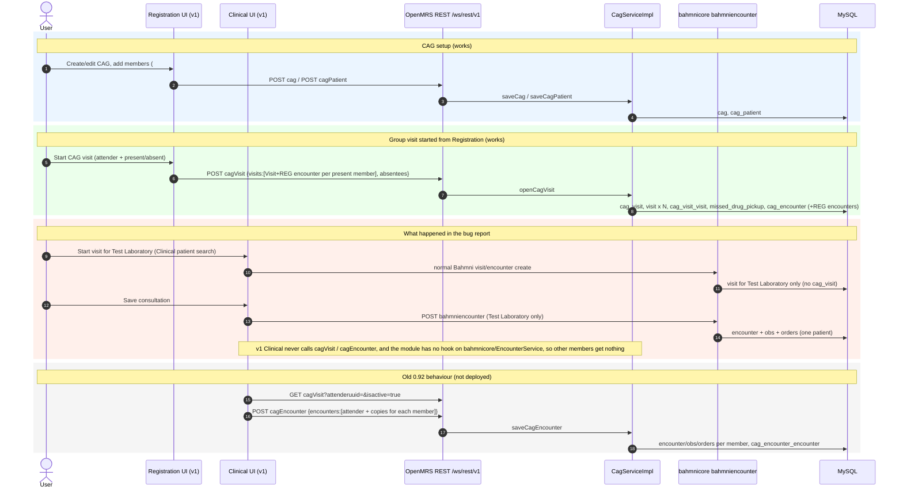
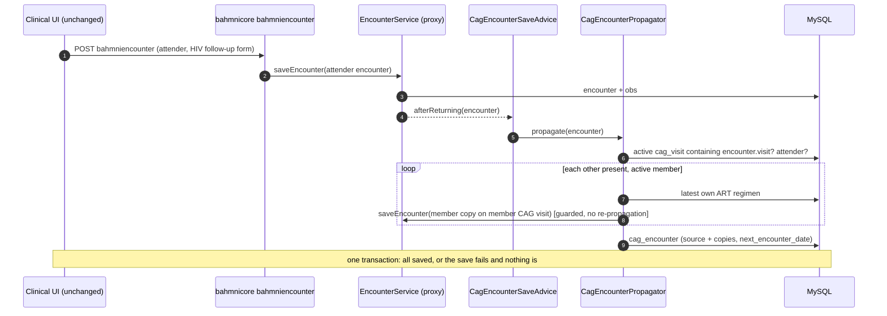

# CAG member data propagation: investigation

Status: **Fix built on branch `fix/cag-member-data-propagation`, but the running server has the old May 7 module (see §10, re-checked 2026-11-11).** Post-deploy verification (Phase 4.4) pending.

Bug: clinical data captured for one CAG member is not copied to the other members of CAG `64feb3c1-601e-4ebb-9b55-265939125843` (test patient "Test Laboratory").

## 1. Architecture

### Repos and what is deployed
| Part | Where | Deployed |
|---|---|---|
| Backend module | `openmrs-module-cag` (`main`, `4d78704`, version `1.0.3-SNAPSHOT`) | `/var/lib/v1/openmrs-v1-modules/cag-1.0.3-SNAPSHOT.omod`, byte-identical to `omod/target/` (built 12 Sep) |
| Registration UI | `openmrs-module-bahmniapps-ls`: `ui/app/registration/services/cagService.js`, `controllers/cagRegisterController.js` | In `omrsregrepo/bahmni-web:1.1.0-06Nov26` |
| Clinical UI | `openmrs-module-bahmniapps-ls/ui/app/clinical` | **No CAG code at all** |
| Old UI (Bahmni 0.92) | `bahmniapps092beta/ui/app/clinical/consultation/controllers/consultationController.js`, `clinical/common/services/cagConsultationService.js` | Not deployed |

Docker: `bahmni-standard-openmrs-1` (`bahmni/openmrs:1.1.2`, OpenMRS 2.5.x), `bahmni-standard-openmrsdb-1`, `bahmni-standard-bahmni-web-1`.

### Module wiring
- `omod/src/main/resources/config.xml`: activator, 4 REST resources, admin-list extension. **No `<advice>`** (the AOP block is the commented-out template, lines 54-59).
- `api/src/main/resources/moduleApplicationContext.xml`: `cagDao` (`HibernateCagDao`) and `cagService` (`CagServiceImpl`) in a `TransactionProxyFactoryBean`. No listeners, no AOP beans.
- `CagActivator`: only logs "Started Cag".
- No `EncounterDataPostSaveCommand`, no `BahmniEncounterTransaction` hook, no event/ActiveMQ subscriber, no DB trigger anywhere in the module.

### Tables (`api/src/main/resources/liquibase.xml`)
| Table | Key columns | Links to |
|---|---|---|
| `cag` | `cag_id`, name, description, village, constituency, district, uuid, audit/void cols | |
| `cag_patient` | `cag_patient_id`, `cag_id`, `patient_id`, `status` (1 = active), `uuid` (= patient uuid) | `cag`, `patient` |
| `cag_visit` | `cag_visit_id`, `cag_id`, `patient_id` (attender), `date_started`, `date_stopped`, `location` (name, varchar), `active`, uuid, audit/void cols | `cag`, `patient` |
| `cag_visit_visit` | `cag_visit_id`, `visit_id` | `cag_visit`, `visit` |
| `cag_encounter` | `cag_encounter_id`, `cag_id`, `cag_visit_id`, `location_id`, `patient_id` (attender), `cag_encounter_datetime`, `next_encounter_date`, uuid, audit/void cols | `cag`, `cag_visit`, `location`, `patient` |
| `cag_encounter_encounter` | `cag_encounter_id`, `encounter_id` | `cag_encounter`, `encounter` |
| `missed_drug_pickup` | `cag_visit_id`, `patient_id`, `reason_missed` | `cag_visit`, `patient` |

### Domain model (`api/.../cag/`)
- `Cag`: group; `cagPatientList` is `@Transient`, filled from `cag_patient`.
- `CagPatient`: membership (`status` true/false; removal sets it false).
- `CagVisit`: one group visit; `attender` = member who came; `visits` = one OpenMRS `Visit` per present member (`cag_visit_visit`); `absentees` is `@Transient`, stored in `missed_drug_pickup`.
- `CagEncounter`: one group consultation; `encounters` = one OpenMRS `Encounter` per member (`cag_encounter_encounter`).
- `Absentee`: `missed_drug_pickup` row.

### REST endpoints (`/openmrs/ws/rest/v1/...`)
| Resource | Methods | Payload / params | Service call |
|---|---|---|---|
| `cag` | GET all/by uuid, `?patientuuid=` search, POST create, POST `/{uuid}` update, DELETE | `{name, description, village, constituency, district, cagPatientList:[patient uuids]}` | `saveCag`, `updateCag`, `deleteCag`, `searchCagByMemberUuid` |
| `cagPatient` | GET `/{uuid}`, POST, DELETE `/{patientUuid}` | `{cag:{uuid}, patient:{uuid}}` | `saveCagPatient`, `deletePatientFromCag` |
| `cagVisit` | GET, `?attenderuuid=&isactive=`, POST create, POST `/{uuid}` close, DELETE | create: `{cag, dateStarted, attender, absentees:{uuid:reason}, visits:[full Visit with nested encounters], locationName}`; close: `{dateStopped:"yyyy-MM-dd HH:mm:ss"}` | `openCagVisit`, `closeCagVisit`, `searchCagVisits`, `deleteCagVisit` |
| `cagEncounter` | GET, `?caguuid=`, POST create, POST `/{uuid}` update, DELETE | create: `{cag, cagVisit, location, attender, cagEncounterDateTime, nextEncounterDate, encounters:[full Encounter per member with obs/orders]}`; update: `{location, nextEncounterDate}` | `saveCagEncounter`, `updateCagEncounter`, `deleteCagEncounter` |

### The propagation mechanism
**There is no server-side propagation.** The module never reacts to a visit or encounter saved through OpenMRS or bahmnicore. It only stores what the client sends:
- `openCagVisit` (`CagServiceImpl.java:149-184`) saves a `cag_visit` and the `Visit` objects the client built, one per present member. It then creates a `cag_encounter` linking the first encounter of each visit.
- `saveCagEncounter` (`CagServiceImpl.java:287-379`) saves the `Encounter` objects the client built, **one per member, already populated with that member's obs and orders**, and links them to the `cag_encounter`.

The copying of the attender's data to the other members was done **in the browser**, by the Bahmni 0.92 Clinical consultation controller:
- `bahmniapps092beta/.../consultationController.js:645-915`: on save, checks whether the patient is in a CAG with an active `cagVisit` (`?attenderuuid=&isactive=true`). If so, it builds the payload and POSTs it.
- `createCagEncounter` (same file, `969-1373`): builds one encounter for the attender (`attenderData`, line ~1196) and one per other member (`otherCagMemberData`, ~1200-1347), copying the HIV follow-up form values and next-visit date, then POSTs `cagEncounter`.

The v1 Clinical app (`openmrs-module-bahmniapps-ls/ui/app/clinical`) has none of this code. `git log --grep=cag` in that repo shows only registration work (CAG search/register, start/close group visit). Nothing was ever ported to Clinical.

## 2. Frontend REST calls (v1)
| Action | Where | Calls |
|---|---|---|
| (a) Save CAG / members | Registration `#/cag/...`, `cagService.js` | `POST cag`, `POST cagPatient`, `DELETE cagPatient/{uuid}` |
| (b) Start group visit | Registration CAG page, `cagService.startVisit` (`cagService.js:222-257`) | `POST cagVisit` with one Visit per present member (nested REG encounter), absentees map |
| (b') Start visit from Clinical | Clinical patient search, normal Bahmni flow | Standard `visit` / bahmnicore calls only. **No `cagVisit` is created** |
| (c) Save consultation | Clinical consultation, standard Bahmni flow | `POST bahmnicore/bahmniencounter` for the one patient. **No `cagEncounter` call** |

## 3. Sequence diagram



## 4. Root cause (confirmed, see §6 and §7)
Root cause: **propagation is a client-side feature of the 0.92 Clinical app that was not ported to v1**, and the backend has no hook of its own.
- Confirmed from code: no `<advice>`, listener or post-save command in the module. No CAG calls in v1 Clinical.
- Also likely in this test: the visit was started from **Clinical**, not from the Registration CAG page, so no `cag_visit` exists and the other members got no visits at all. To check in the DB.

## 5. Other defects found while reading (not the main cause)
1. `cagService.js:223` (and `closeVisit`, line 112) builds `dateStarted` with `toISOString()`, which is **UTC**. The server stores it as Africa/Maseru, so group visits start 2 h early. Close-by-exact-start-time (`HibernateCagDao.closeCagPatientVisit`) stays consistent, but any "visit active on date" matching is off around midnight.
2. `cagService.js:166-185`: the attender's REG encounter is saved with **hardcoded BP 120/73 and pulse 24**, carried over from the 0.92 flow. These are fabricated vitals in a real patient record.
3. Unmerged branch `origin/cag-link-encounters-to-visit` (`254615496`): states that OpenMRS 2.5 does not persist `encounter.visit` for encounters nested in a Visit POST, so members' REG encounters end up with no visit. Not on `fixing-alert`.
4. `CagServiceImpl.saveCagEncounter`: orders loop uses `index += 2` (lines 340, 368), so only every second order is saved. It also overwrites every order's instructions with "As directed".
5. `saveCagEncounter` (no-cagVisit branch) uses hardcoded `new VisitType(10)` (line 320) and has a dead `calendar1` (line 312).
6. `openCagVisit` line 179: `getNonVoidedEncounters().get(0)` throws `IndexOutOfBoundsException` for a visit with no encounters.
7. `searchCagByMemberUuid` runs the same query twice and returns the second result (lines 87-97). **Correction:** Hibernate returns the same cached instance both times, so the member list is not actually lost; it is only a redundant query (a regression test passes on the old code).
8. `Cag.java:6` imports `jdk.internal.dynalink.linker.LinkerServices`, which only compiles on JDK 8.
9. `cagVisit` create/close returns a 500 on serialization, which the UI works around (`cagService.js:117-128`).

## 6. Phase 2: live state (REST, 2026-11-09 ~19:00 SAST)
CAG `64feb3c1…` "Test CAG", created 18:39:21. Module `cag 1.0.3-SNAPSHOT` started, no startup error.

**Members** (all `cag_patient.status` active):
| Member | Patient uuid |
|---|---|
| test laboratory (attender) | `e5f0fb7d-ae56-4d25-a57d-b2bf1a28ae5c` |
| test moliehi | `5a004aab-4d3e-42e6-b3aa-8df5036f3bc7` |
| MPATENG MOHAPI | `c2eca4ff-a9cc-459a-9014-c2f40088fb48` |

**CAG visit** `c616721e-ede2-4e79-8c7d-cac3745fb033`: active, attender test laboratory, 3 linked visits (`cag_visit_visit` OK). `dateStarted` = 16:39:35 +0200, but the POST happened at 18:39:35 (access log). **Confirms the UTC bug (§5.1).**

**Member visits** (visit type CAG, ART Clinic, start 16:39:35, open):
| Member | Visit | Encounters on visit |
|---|---|---|
| test laboratory | `b882df20…` | 1 REG `b528ce6a` 18:40:11 with BMI Data 34.6 / Obese (saved via `bahmnicore/bahmniencounter`) |
| test moliehi | `28551d9f…` | **none** |
| MPATENG MOHAPI | `aca0ccf6…` | **none** |

test moliehi also has a second **open** visit, `b83c5fb6…` (ARV Drug Pickup, started 11:55 the same day). Clinical may pick either one as "active".

**CAG encounter** `54925584-102e-4a1b-aaf1-1900a91f73ad` (made by `openCagVisit`): links 3 REG encounters `e8676d59` (moliehi), `6f24e424` (MOHAPI), `39c1966c` (laboratory). All three have **`visit = NONE`, no provider**, and only the `Nutritional Values` group obs. So the encounters nested in the `cagVisit` POST are saved, but are not attached to their visits (§5.3 confirmed).

**Access log** (`localhost_access_log.2026-11-09.txt`), 18:38-18:43:
```
18:39:21 POST /openmrs/ws/rest/v1/cag 201
18:39:35 POST /openmrs/ws/rest/v1/cagVisit 201
18:40:11 POST /openmrs/ws/rest/v1/bahmnicore/bahmniencounter 200   <- test laboratory BMI
18:40:52 GET  .../bahmnicore/visit/summary?visitUuid=b882df20...    <- Clinical opens the visit
```
No `POST .../cagEncounter` appears in any access log; the only `cagEncounter` hits are my own GETs. **The data saved for test laboratory went to bahmnicore for that patient only, and nothing asked the CAG module to copy it.**

No consultation (Consultation encounter type) has been saved on the CAG visit yet. Next: capture logs while one is saved.

### SQL evidence (read-only `SELECT`s, MySQL `openmrs`, server tz = SYSTEM, `NOW()` 19:14 SAST)
```
cag_patient:     1 -> 9584 test laboratory  status=1
                 2 -> 9585 test moliehi     status=1
                 3 -> 9388 MPATENG MOHAPI   status=1
cag_visit:       id=1 attender=9584 date_started=2026-11-09 16:39:35 date_created=2026-11-09 18:39:35 active=1
cag_visit_visit: 1 -> visits 20315 (9584), 20316 (9585), 20317 (9388), all type CAG, ART Clinic, open
cag_encounter:   id=1 cag_visit_id=1 location_id=NULL next_encounter_date=NULL
cag_encounter_encounter -> encounter 36009 (9585) / 36010 (9388) / 36011 (9584)
                 all REG, visit_id=NULL, 0 encounter_provider rows
missed_drug_pickup: no rows
```
Encounters on the three CAG visits: only **36012** (visit 20315, test laboratory, REG, 18:40:11, 11 obs). Visits 20316 and 20317 have **no encounters**.

Open visits: 9585 (test moliehi) has **two**: 20311 ARV Drug Pickup from 11:55 and 20316 CAG.

**Fabricated obs on the attender** (encounter 36011, from `cagService.buildPresentVisit`):
| obs_id | concept | value |
|---|---|---|
| 549930 | Systolic | 120 |
| 549934 | Diastolic | 73 |
| 549931 | **IMAM, MUAC** | 24 (the UI meant "pulse"; `PULSE_UUID` resolves to MUAC in this dictionary) |
| 549932 | TB Status | No signs |
| 549933 | HTC, Patient type | HTC, Patient |

These are not measurements: they are hardcoded in `cagService.js:166-185` and written into every attender's record on each group-visit start. Buddies get only `HTC, Patient type = HTC, Buddy`. **Not modified**; cleanup needs your decision.

### Log capture
`docker logs -f` and the Tomcat access log tail run from 19:05. As of 19:16 there are no saves and no CAG requests. The only errors are the OpenELIS atomfeed job (`UnknownHostException: openelis`, no such container), which is unrelated.

## 7. Phase 3: hypothesis checklist
| Hypothesis | Verdict | Evidence |
|---|---|---|
| Propagation hook not registered / not firing | **Confirmed: there is no hook at all** | `config.xml` had only the commented template `<advice>`; no listener, no post-save command, no trigger in the module. Module itself is started (`GET module/cag`: `started:true`). |
| Bahmni saves via `bahmnicore/bahmniencounter`, bypassing CAG | **Confirmed (contributing)** | Access log 18:40:11 `POST bahmnicore/bahmniencounter`; no `POST cagEncounter` anywhere. The only CAG write path for consultations was the 0.92 browser call, which v1 Clinical does not have. |
| Visit matching: type / location / time zone / missing link row | Ruled out as the cause; **time zone defect confirmed** | `cag_visit_visit` has all 3 links; all visits are CAG @ ART Clinic. Start time is stored 2 h early (UTC from the browser), which does not block matching because the attender's encounter is later. Test moliehi's extra open ARV Drug Pickup visit could make Clinical pick the wrong visit for them. |
| Encounter cloning (shared Obs, uuid clashes, providers) | Not reached (no cloning ran). In the old `saveCagEncounter` path: providers never set, `index += 2` order skip. | `cag_encounter_encounter` REG encounters have 0 providers. |
| Transaction / swallowed exceptions / privileges | Ruled out | No CAG exceptions in `docker logs` or the captured tail; only unrelated OpenELIS feed errors. Nothing ran to fail. |
| Member status filters / off-by-one | Ruled out for this CAG | All 3 `cag_patient.status = 1`. `cagService.startVisit` builds a visit for each present member, attender included. |
| Frontend not calling CAG endpoint / wrong uuid | **Confirmed** | v1 `ui/app/clinical` has no CAG code; registration only calls `cag`, `cagPatient`, `cagVisit`. |
| `pom.xml` vs deployed version mismatch | **Confirmed (build hygiene)** | Built against OpenMRS **1.11.6**, deployed on **2.5.14**; `require_version` 1.11.6; tests could not run. Not the cause of the bug, fixed anyway. |
| (found) REG encounters from `openCagVisit` saved with `visit_id = NULL` | **Confirmed** | SQL: encounters 36009/36010/36011 `visit_id NULL`. Reproduced by `OpenCagVisitTest`. |

## 8. Fix (branch `fix/cag-member-data-propagation`)
**Server-side propagation**, so it works whichever UI saves the data:
- `api/.../advice/CagEncounterSaveAdvice.java`: `AfterReturningAdvice` on `EncounterService.saveEncounter` (what `bahmnicore/bahmniencounter` calls). A thread-local guard stops it re-firing for the members' copies. Declared in `omod/.../config.xml` `<advice>`.
- `api/.../api/propagation/CagEncounterPropagator.java` does the mapping, matching what the 0.92 app sent:
  - Only when: encounter type is in `cag.propagation.encounterTypeUuids` (default Consultation); the encounter's visit belongs to an **active** `cag_visit`; and the patient is that CAG visit's **attender**. Saves for members, other encounter types or closed CAG visits do nothing.
  - For each other visit in `cag_visit_visit` whose patient is still an active member (`cag_patient.status = 1`): one encounter on **their** CAG visit, same type, time, location, providers and form.
  - The member's copy of the "HIV Treatment and Care Progress Template" keeps only: days dispensed, supply duration, appointment scheduled, follow-up date (copied as-is, in the same `Regimen` group); **Type of client = Treatment Buddy**; **ART Regimen = the member's own latest regimen** (left out if they have none). Everything else on the attender's form (adherence, functional status, vitals...) is **not** copied.
  - Source and copies are linked by one `cag_encounter` (`next_encounter_date` = follow-up date). Re-saving the attender's form updates each copy in place (old form obs voided, new one added) only when the mapped answers changed; removing the form from the attender's encounter voids it on the copies.
  - Runs inside the attender's save transaction: if a copy fails validation, the whole save fails visibly instead of leaving members half-updated. Members whose CAG visit ended before the encounter are skipped with a WARN log.
  - All concept / encounter type uuids are global properties (`cag.propagation.*`, defaults in `CagConstants`), plus `cag.propagation.enabled` as an off switch.
- `CagServiceImpl.openCagVisit`: sets `encounter.visit` on the REG encounters nested in each Visit before saving (fixes `visit_id = NULL`), and no longer throws on a visit with no encounters.
- `CagServiceImpl.searchCagByMemberUuid`: returns the instance it filled instead of re-querying.
- Build: `openmrsPlatformVersion` 1.11.6 → **2.5.14**, `require_version` → 2.5.0; legacyui-omod 1.21.0 (`provided`) for `AdminListExtension`; removed unused `emrapi-api-1.12` dependency and the JDK-internal / simpleframework imports; JUnit 4.13.2, Mockito 3.12.4, PowerMock 2.0.9 in test scope; API Spring scan now excludes `org.openmrs.module.cag.web.*` (loaded by `webModuleApplicationContext.xml` anyway).

**Not changed (deliberately):** the `index += 2` drug-order loop and "As directed" overwrite in `saveCagEncounter`. Nothing in v1 calls that path, the intent is unclear, and there is no test for it.

### Flow after the fix


### Tests (`mvn clean install`: 9 api + 2 omod, all pass)
`api/src/test/.../propagation/CagEncounterPropagationTest` uses `CagPropagationTestDataset.xml`, which mirrors CAG 64feb3c1 with the real concept uuids. It registers whatever `<advice>` `omod/src/main/resources/config.xml` declares, so an undeclared hook also fails.

| Test | Before fix | After |
|---|---|---|
| `attenderFollowUp_shouldBeMappedOntoEachPresentMembersCagVisit` | **fails**: member 6 has 0 encounters on CAG visit | pass |
| `editingTheAttenderForm_shouldUpdateCopiesWithoutDuplicates` | **fails** (same) | pass |
| `removedMember_shouldNotReceiveData`, `memberConsultation_shouldNotPropagate`, `otherEncounterTypes_shouldNotPropagate`, `closedCagVisit_shouldNotPropagate` | pass (nothing propagated) | pass (guards against over-propagation) |
| `OpenCagVisitTest.openCagVisit_shouldAttachNestedEncountersToTheirVisits` | **fails**: 0 encounters on visit | pass |
| `OpenCagVisitTest.openCagVisit_shouldAcceptAVisitWithoutEncounters` | **fails**: `IndexOutOfBoundsException` | pass |
| `OpenCagVisitTest.searchCagByMemberUuid_shouldReturnTheMemberList` | pass | pass |

### Deploy (not done; needs your go-ahead)
```bash
cd /home/kgatman/bahmniDev/openmrs-module-cag && mvn clean install
# back up OUTSIDE the modules folder, or OpenMRS loads both copies
cp /var/lib/v1/openmrs-v1-modules/cag-1.0.3-SNAPSHOT.omod ~/cag-1.0.3-SNAPSHOT.omod.bak-2026-11-09
# remove the old file: two cag versions in the folder would both try to load
rm /var/lib/v1/openmrs-v1-modules/cag-1.0.3-SNAPSHOT.omod
cp omod/target/cag-1.0.4-SNAPSHOT.omod /var/lib/v1/openmrs-v1-modules/
cd /var/lib/v1/bahmni-docker-ls/bahmni-standard
docker compose --env-file .env --env-file .env.secrets restart openmrs
docker logs -f bahmni-standard-openmrs-1 2>&1 | grep -iE 'cag|Started Cag|Exception'
```
Rollback: delete `cag-1.0.4-SNAPSHOT.omod`, copy the `.bak` file back as `cag-1.0.3-SNAPSHOT.omod`, and restart `openmrs` again. No schema changes, so rollback is clean; the `cag.propagation.*` global properties stay but are unused.

## 9. Remaining risks / follow-ups
- **Not verified on the live server yet.** Assumes Bahmni's consultation save goes through the advised `EncounterService` proxy (it does in emrapi/bahmnicore, but verify after deploy).
- **Registration UI (other repo), not fixed here:** hardcoded vitals in `buildPresentVisit` (BP 120/73, "pulse" 24 stored as **IMAM, MUAC**, TB Status "No signs") written to every attender; UTC `dateStarted`. The backend fix makes `origin/cag-link-encounters-to-visit` unnecessary.
- **Existing bad data:** fabricated obs 549930-549934 on encounter 36011 (test laboratory) and the same pattern for any earlier attender; the three REG encounters with `visit_id NULL`. Cleanup needs your decision.
- Members with **two open visits** (test moliehi: 20311 + 20316): the copy goes to the CAG visit, but Clinical may show the other visit as "active".
- Copies are created only for members present at group-visit start (those with a visit in `cag_visit_visit`). Absentees get nothing, matching the old behaviour.
- Version bumped to `1.0.4-SNAPSHOT` (author `MoH-Lesotho`), so the new build is distinguishable from the deployed `1.0.3-SNAPSHOT`.
- The `target/` folder is committed in this repo; the branch commits only sources.

## 10. Phase 1 re-check (2026-11-11, read-only)
§1-§3 still describe the code on `main` and the deployed module correctly. New or changed:

1. **The fix is not running.** `/var/lib/v1/openmrs-v1-modules/cag-1.0.3-SNAPSHOT.omod` (45,850 bytes, md5 `b360c084…`, written by root 2026-11-10 13:50) is the May 7 build: `require_version` 1.11.6, `<advice>` still commented out, no `advice` or `propagation` classes. The branch build is `omod/target/cag-1.0.3-SNAPSHOT.omod` (61,208 bytes, md5 `d7b3a6b7…`).
2. **Deploying by copying the file does not last.** The modules folder is a git checkout whose tracked blob is that May 7 build (commit `2eb7275`). The file's root ownership and timestamp match other repos reset at 13:50 on Nov 10, so an installer or catch-up run most likely restored it (inferred, not proven). `eregister-autopull` skips a dirty checkout, but a reset would restore the old module. The new `.omod` has to be committed to `openmrs-v1-modules`.
3. **Possible gap in the fix: form shape.** `CagEncounterPropagator` needs a top-level obs of concept `746818ac…` (HIV Treatment and Care Progress Template). The Form Builder form `HIV Treatment and Care Follow Up 2026` v3 does not contain that concept: "Type of client" is a top-level obs and the other mapped questions sit in a top-level `Regimen` group. A save from that form makes `findTopLevel` return null, so nothing is copied and nothing is logged. The tests only build the Template-wrapped shape. Which shape real consultations use must be confirmed from the `obs` table in Phase 2.
4. **Scope.** The branch copies 4 answers, sets client type and fills the member's own regimen. It does not copy drug orders, other obs or other encounter types. The 0.92 code also had orders commented out (`consultationController.js:1027`, `:1214`).
5. Ruled out: emrapi's `FlushMode.MANUAL` losing the copies. `EmrEncounterServiceImpl.save` restores the previous flush mode before returning, so the `beforeCommit` work is flushed at commit.

